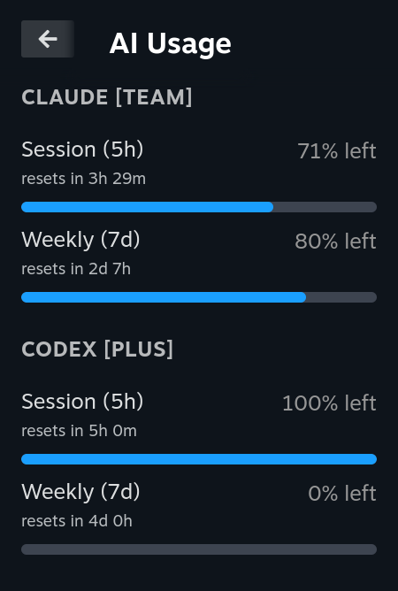

# AI Usage (Decky plugin)

Shows Claude Code and OpenAI Codex usage quotas (session / weekly windows,
extra-usage cost) in the Steam Deck Quick Access menu. Ported from
[ai-usage-cli](https://github.com/jason9075/ai-usage-cli).



Credentials are read from `~/.claude/.credentials.json` and `~/.codex/auth.json`
and are never refreshed or rewritten. If a token expires, run `claude` or
`codex` once to refresh it.

Requires Decky Loader 3.x.

## Build & install

```bash
npm install
npm run build
sudo rm -rf ~/homebrew/plugins/ai-usage
sudo mkdir -p ~/homebrew/plugins/ai-usage
sudo cp -r dist main.py plugin.json package.json README.md ~/homebrew/plugins/ai-usage/
sudo systemctl restart plugin_loader
```

Or install from Gaming Mode without sudo: run `npm run package`, then in Decky
enable **Settings → General → Developer mode** and use
**Developer → Install Plugin from ZIP File** on `out/ai-usage.zip`.
